# Awesome-Cloud-Based-Web-Testing-Environment

  

  
  
  
  
  
  

## 🌐 Top Cloud-Based Web Testing Environment Ecosystem

> **Curated directory of SaaS products, cloud test execution platforms, and open-source self-hosted browser grid infrastructure.**  
> *Targeted at QA engineers, SDETs, DevOps, and Platform teams managing cross-browser testing, remote browser automation, and scalable Kubernetes-native grid nodes.*  
> **📅 Last updated: March 2026**

---

### 🔍 Overview & Architecture

This repository tracks notable **SaaS platforms** and **open-source projects** powering modern **Cloud-Based Web Testing Environments**. These tools deliver instant, elastic access to remote browsers and mobile devices for manual and automated test suites—eliminating the overhead of provisioning physical device labs, virtual machines, or fragile local browser matrices while enabling engineering teams to validate web applications across thousands of browser, operating system, and screen resolution combinations simultaneously.

Whether deploying enterprise cross-browser clouds or orchestrating vendor-neutral Kubernetes browser clusters, this guide indexes key solutions across:
- 🧪 **Cross-Browser Automation Clouds**: Scalable execution clouds for Selenium, Playwright, Cypress, and Puppeteer.
- 📱 **Real Device & Virtual Emulation Farms**: Physical mobile devices and virtual containers for automated web and responsive UI verification.
- ⚡ **Kubernetes-Native Ephemeral Grids**: Self-hosted, lightweight containerized browser pods that spin up on demand and terminate instantly after session completion.
- 👁️ **Visual Regression & Live Debugging**: Real-time interactive browser sessions, visual DOM diffing, and automated video recording.

---

## 📑 Table of Contents
- [📊 Sector Overview & Market Dynamics](#-sector-overview--market-dynamics)
- [☁️ SaaS & Hosted Cloud Platforms](#️-saas--hosted-cloud-platforms)
- [💻 Open-Source GitHub Projects](#-open-source-github-projects)
- [🛠️ Architectural Building Blocks](#️-architectural-building-blocks)
- [🤝 How to Contribute](#-how-to-contribute)
- [📈 Star History](#-star-history)
- [💖 Support & Sponsorship](#-support--sponsorship)
- [⚖️ Disclaimer](#️-disclaimer)

---

## 📊 Sector Overview & Market Dynamics

The global cloud-based web and cross-browser testing market is valued between **$1.99 billion and $14.1 billion in 2026** (depending on the inclusion of broader cloud quality assurance services vs. dedicated browser infrastructure grids), with projected double-digit annual growth driven by continuous delivery pipelines and multi-cloud architectures. 

The sector is **moderately fragmented**: while a small cohort of scale-stage leaders (BrowserStack, SmartBear, Sauce Labs, and LambdaTest) commands enterprise demand with massive real-device clouds, a vibrant ecosystem of specialized point tools, API-driven testing utilities, and self-hosted open-source grid runners (Playwright, Moon, WebSummoner) actively maintains competitive fragmentation.

---

## ☁️ SaaS & Hosted Cloud Platforms

Curated list of commercial SaaS cloud testing grids, sorted descending by company scale (valuation / annual revenue run-rate):

| Product | 🏢 Valuation / Scale | 📝 Description | 💳 Starting Pricing | 🎁 Free Tier / Trial Limits |
|---------|---------------------|----------------|---------------------|-----------------------------|
| **[BrowserStack Web Testing Cloud](https://www.browserstack.com/)** | **$4.0B Valuation** (~$230M ARR) | Cloud testing platform with 3,000+ desktop browser combinations and 30,000+ real mobile devices. Live (manual) and Automate (Selenium/Playwright/Cypress) products share the same device infrastructure. | Live Desktop: $12.50/month per user (billed annually, 100 minutes) or $19/user/month month-to-month; Automate: from $129/parallel/month (annual) | Free Trial: 30 minutes Live manual interactive testing, 100 minutes Automate test execution; permanent free plan available for qualifying open-source projects via application [citation:1][citation:11] |
| **[BitBar Desktop (SmartBear)](https://smartbear.com/product/bitbar/)** | **$1.8B–$1.9B Valuation** (~$150M+ Suite Revenue) | Cloud device and browser testing platform with real mobile devices and desktop browsers. Live Testing (manual) and BitBar Unlimited (live + automated with Selenium/Appium/TestComplete). | Live Testing: €45/parallel/month (billed annually); BitBar Unlimited: €202/parallel/month (annual) | 14-day free trial (no credit card required, access to real mobile/desktop devices with default 10-minute session execution timeout); free plan for qualifying open-source projects [citation:16][citation:17] |
| **[CrossBrowserTesting (SmartBear)](https://smartbear.com/product/crossbrowsertesting/)** | **$1.8B–$1.9B Valuation** (~$150M+ Suite Revenue) | Cloud testing platform with 1,500+ real desktop and mobile browsers. Supports manual testing, screenshot comparison, and parallel automated tests (retired/consolidated into BitBar). | Standard: $104/month (or equivalent BitBar Live tier at €45/parallel/month annual) | 7-day free trial (capped at 60 minutes total testing time across live/automated sessions, no permanent free tier) [citation:5] |
| **[Sauce Labs Web Testing](https://saucelabs.com/)** | **$613M Valuation** (~$90M–$100M ARR) | Enterprise cloud testing with Live Testing (manual), Virtual Device Cloud (emulators/simulators), and Real Device Cloud (physical devices). Supports Selenium, Playwright (via CDP), Cypress, and mobile testing. | Live Testing: $39/month (billed annually, 1 parallel session); Virtual Cloud: $149/month (annual, 1 parallel); Real Device Cloud: $199/month (annual) | 28-day free trial (includes 60 automated/live testing minutes, 3 virtual machines in parallel, and 50 AI queries; no permanent free tier; sponsorship available for open-source projects) [citation:2][citation:12] |
| **[LambdaTest Browser Cloud](https://www.lambdatest.com/)** | **$400M Valuation** (~$21M+ ARR) | Cloud grid with 10,000+ browser/OS combinations and real devices. Live testing from $15/month (annual). Free tier provides 60 minutes/month realtime browser testing, 100 lifetime automation minutes, and 1 parallel test. | Live: $15/month (billed annually); Web Automation: $99–$119/month per parallel session (annual) | Free Forever Plan: 60 minutes/month realtime browser testing, 100 lifetime automation minutes, 10 screenshot tests/month, 1 parallel session, 30-day log/data retention [citation:3] |
| **[TestGrid Web Cloud](https://testgrid.io/)** | **~$5M+ ARR** (Pre-Series A / Multi-Million Backed) | AI-powered test automation platform with real devices, real browsers, visual testing, and page performance testing. Starter package includes AI test generation, 27+ testing agents, and self-healing. | Manual Testing: $25/month; End-to-End Automation: $99/month; AI TestOS Starter: $199/seat/month | Free Forever Plan: 200 minutes/month test execution time, up to 5 user seats, basic automation and real-device testing; guided 1–2 week enterprise proof-of-concept trial [citation:9][citation:23] |
| **[TestingBot Web Cloud](https://testingbot.com/)** | **€1M–€10M Revenue** (Bootstrapped) | Cloud testing with 6,100+ browser/OS combinations and real iOS/Android devices. Supports Selenium, Cypress, Playwright, Puppeteer, and Appium. | Live: $20/month (billed annually); Automated: $50/month (annual, 1 parallel); Automated Pro: $90/month (annual) | 14-day free trial (no credit card required, 100 automated minutes & 100 live testing minutes); Free forever plan for qualifying open-source projects (unlimited automated tests, 2 parallel sessions) [citation:4][citation:14] |
| **[Moon Cloud (Aerokube)](https://aerokube.com/moon/)** | **< €1M Revenue** (Bootstrapped) | Kubernetes-native browser automation cloud supporting Selenium, Playwright, Puppeteer, and Cypress in a single cluster. Deploys via Helm with official Chrome, Firefox, and Edge images. | $5/parallel session per month | Free Forever Tier: up to 4 parallel browser sessions/pods with zero license key required; evaluation keys of larger session capacity provided via Moon Assistance Program until production [citation:6] |
| **[Browserling](https://www.browserling.com/)** | **Bootstrapped Micro-SaaS** (~$55K Seed) | Online browser testing with real browsers and OS versions (Windows 10/11, macOS, iOS, Android). Web Testing plans start at $9/month (annual) for Starter (Windows 10, Chrome/Edge). Free Sandbox available with limited session time. | Starter: $9/month (billed annually); Developer: $19/month (annual); Developer Pro: $29/month (annual) | Free Sandbox Plan: unlimited sessions with strict 3-minute session execution limit, Windows 10 only, Chrome & Edge access with basic screenshot capture [citation:24][citation:30] |
| **[Comparium](https://comparium.app/)** | **Bootstrapped / Utility SaaS** (Private) | Cloud-based cross-browser visual testing and screenshot comparison tool supporting multi-browser discrepancy evaluation and live interactive sessions. | Standard: $15/month (billed monthly) | Free Forever Plan: 1 parallel task, basic browser versions on public URLs, up to 100 screenshot captures per month with live session timeouts [citation:25][citation:8] |

---

## 💻 Open-Source GitHub Projects

Curated open-source projects for browser grid orchestrators, headless testing engines, and containerized browser infrastructure—**sorted in descending order by GitHub_Stars**:

| Project | ⭐ GitHub_Stars | 📜 License | 📝 Description |
|---------|---------|-----------|----------------|
| **[Playwright](https://github.com/microsoft/playwright)** |  | Apache-2.0 | Microsoft's end-to-end cross-browser automation framework with built-in test runner supporting Chromium, Firefox, and WebKit across Windows, Linux, and macOS. Self-hostable or connects directly to remote cloud grids. |
| **[Puppeteer](https://github.com/puppeteer/puppeteer)** |  | Apache-2.0 | Node.js library providing a high-level DevTools Protocol API to control Chrome/Chromium, widely deployed as the foundation for serverless web test execution and automated rendering clusters. |
| **[Cypress](https://github.com/cypress-io/cypress)** |  | MIT | Fast, reliable developer-centric testing framework executing directly inside the browser DOM alongside your frontend application code with time-travel debugging and network stubbing. |
| **[Selenium](https://github.com/SeleniumHQ/selenium)** |  | Apache-2.0 | Reference hub-and-node architecture for distributed W3C WebDriver execution. Selenium Grid 4 supports distributed tracing, dynamic container scaling, GraphQL status queries, and Appium relays. |
| **[browserless](https://github.com/browserless/browserless)** |  | SSPL-1.0 | Drop-in headless Chrome cloud service for web testing, automation, and scraping. Runs as a scalable Docker container supporting Playwright, Puppeteer, and WebDriver protocols out-of-the-box. |
| **[Nightwatch.js](https://github.com/nightwatchjs/nightwatch)** |  | MIT | End-to-end testing solution for web applications and websites, powered by Node.js and W3C WebDriver with seamless support for remote cloud grids and cross-browser environments. |
| **[TestCafe](https://github.com/DevExpress/testcafe)** |  | MIT | Pure Node.js end-to-end testing tool that runs across all major browsers without needing browser plugins, external WebDriver binaries, or complex local client setup. |
| **[WebdriverIO](https://github.com/webdriverio/webdriverio)** |  | MIT | Next-gen browser and mobile automation test framework for Node.js, supporting both the W3C WebDriver and Chrome DevTools protocols across desktop and cloud grid infrastructures. |
| **[docker-selenium](https://github.com/SeleniumHQ/docker-selenium)** |  | Apache-2.0 | Official Docker images and Docker Compose templates for Selenium Grid 4 featuring standalone, hub, and Chrome/Firefox/Edge node containers ready for cloud and on-prem deployment. |
| **[Selenoid (Archived)](https://github.com/aerokube/selenoid)** |  | Apache-2.0 | Legendary Go-based Docker-container-per-session Selenium hub that revolutionized ephemeral browser testing. Archived December 2024; active setups migrate to Moon or WebSummoner. |
| **[Zalenium (Archived)](https://github.com/zalando/zalenium)** |  | Apache-2.0 | Dynamic, auto-scaling Selenium Grid Docker container with live video recording and dashboard interface that originally pioneered on-demand ephemeral containerized browser nodes. |
| **[Selenoid UI](https://github.com/aerokube/selenoid-ui)** |  | Apache-2.0 | Real-time web dashboard for Selenoid and Moon clusters. Provides live VNC session viewing, interactive manual browser takeover, session status monitoring, and video playback. |
| **[Moon by Aerokube](https://github.com/aerokube/moon)** |  | Commercial / Community (4 Pods Free) | Kubernetes and OpenShift-native browser automation platform supporting Selenium, Playwright, Puppeteer, and Cypress with sub-second pod launch times and live video capture. |
| **[Configuration Manager (cm)](https://github.com/aerokube/cm)** |  | Apache-2.0 | CLI utility to quickly download, configure, and manage Selenoid, Selenoid UI, and browser Docker images with a single terminal command. |
| **[Callisto](https://github.com/wrike/callisto)** |  | Apache-2.0 | Open-source Kubernetes-native implementation of Selenium Grid built by Wrike. Provides high-throughput browser session management and pod lifecycle scaling in production clusters. |
| **[Selenosis](https://github.com/alcounit/selenosis)** |  | Apache-2.0 | Scalable, stateless Selenium Grid alternative for Kubernetes clusters that provisions browser pods on demand and disposes of them immediately upon test completion. |
| **[WebSummoner](https://github.com/WebSummoner/websummoner)** |  | Apache-2.0 | Actively maintained Selenoid successor written in Go (~10MB binary). Drop-in Selenoid API compatible, spawning ephemeral Docker containers per session with minimal overhead. |

---

## 🛠️ Architectural Building Blocks

To construct your own cost-effective, self-hosted web testing cloud:
1. 🔀 **Routing & Ingress**: Use **Selenium Grid 4** or **browserless** to multiplex requests across your worker pool.
2. 🐳 **Ephemeral Session Isolation**: Deploy **docker-selenium** or **WebSummoner** for Docker environments, or **Moon** / **Selenosis** for Kubernetes clusters to ensure every test runs in a clean, untampered browser container.
3. 🎥 **Live Observability & Debugging**: Connect **Selenoid UI** to inspect running sessions via VNC or review recorded screen captures for failed runs.

---

## 🤝 How to Contribute

Contributions are welcome! To contribute:

1. 🍴 Fork the repository.
2. 🌿 Create a new branch: `git checkout -b feature/new-testing-tool`.
3. ✏️ Add or update entries in `README.md` (keep descriptions objective and include official links).
4. 🚀 Submit a Pull Request describing your changes.

---

## 📈 Star History

---

## 💖 Support & Sponsorship

If you find this curated collection useful for your QA infrastructure or cloud testing architecture, please consider:
- ⭐ **Starring** the repository on GitHub
- 🍴 **Forking** and contributing back new tools and grids
- 📢 **Sharing** this repository with fellow QA engineers, test architects, and DevOps practitioners
- ☕ **Buying a coffee / Sponsoring** the maintainer via the [GitHub Sponsors Dashboard](https://github.com/sponsors/ishandutta2007)

Thank you for supporting open-source software and transparent cloud testing ecosystems! 🙌

---

## ⚖️ Disclaimer

- This is a **community-curated directory** created for educational and architectural reference—not an official endorsement of any vendor or tool.
- Cloud web testing environments execute arbitrary browser sessions and scripts; always implement strict authentication, tenant isolation, and ephemeral container cleanup to protect network boundaries.
- Vendor pricing, free tier quotas, and trial durations change frequently; verify directly with official product websites before provisioning production capacity.

---

  <b>Built for QA engineers, test automation architects, and platform teams building scalable web testing infrastructure.</b> 
  Let's make cloud-based web testing transparent, resilient, and vendor-neutral. 🚀

